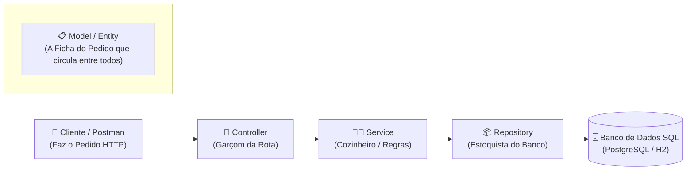
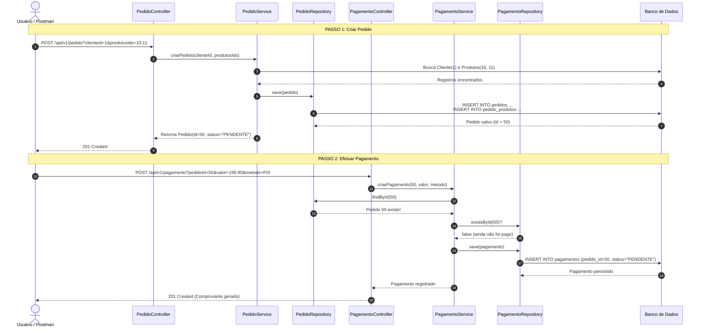

# 🧠 Guia Completo: Arquitetura, JPA e Relacionamentos no Spring Boot

Este documento detalha o funcionamento interno de cada classe, anotação e relacionamento de banco de dados do projeto, explicando a teoria e a prática sem jargões confusos.

---

## 📑 Sumário
1. [A Analogia do Restaurante (Fluxo em Camadas)](#1-a-analogia-do-restaurante)
2. [Java Moderno: Generics e Optional](#2-java-moderno-generics-e-optional)
3. [Os 3 Relacionamentos de Banco (1:N, 1:1, N:N)](#3-os-3-relacionamentos-de-banco)
4. [Dono da Chave vs mappedBy](#4-dono-da-chave-vs-mappedby)
5. [Diagrama de Classes (UML)](#5-diagrama-de-classes-uml)
6. [Diagrama Entidade-Relacionamento do Banco (ER)](#6-diagrama-entidade-relacionamento-do-banco-er)
7. [Diagrama de Sequência (Ciclo de Vida da Compra)](#7-diagrama-de-sequência)

---

## 1. A Analogia do Restaurante

Imagine o sistema como o funcionamento de um restaurante de alta gastronomia:



| Camada | Classe no Projeto | Papel Prático |
| :--- | :--- | :--- |
| **Controller** | `ClienteController`, `PedidoController` | **O Garçom:** Atende a porta da rua (HTTP JSON). Ele não cozinha e não mexe no estoque. Apenas recebe os parâmetros e devolve a resposta HTTP final (200, 201, 404). |
| **Service** | `ClienteService`, `PedidoService` | **O Cérebro:** Onde as regras de negócio vivem (*"O cliente existe?"*, *"A senha está vazia?"*, *"O pedido já foi pago?"*). |
| **Repository** | `ClienteRepository`, `PedidoRepository` | **O Estoquista:** A interface que estende `JpaRepository`. Faz as operações SQL diretamente no disco (`save`, `findById`, `delete`). |
| **Model** | `ClienteModel`, `PedidoModel`, etc. | **A Ficha de Papel:** A classe anotada com `@Entity` que define as colunas e os relacionamentos. |

---

## 2. Java Moderno: Generics e Optional

### A) Por que usamos Generics (`List<ProdutoModel>`)?
Em Java antigo era permitido escrever `List lista = new ArrayList()`. Hoje em dia usamos Generics `<ProdutoModel>` por dois motivos fundamentais:
1. **Segurança de Tipos:** Garante em tempo de compilação que só entram objetos `ProdutoModel` naquela lista.
2. **Inteligência do JPA:** O Spring Data inspeciona o `<ProdutoModel>` para descobrir qual tabela do banco de dados deve ser ligada pela chave estrangeira.

### B) O que significa o retorno `Optional<T>` do `findById`?
Quando você faz `repository.findById(id)`, o JPA não retorna o objeto direto nem retorna `null`. Ele retorna uma caixa: **`Optional<T>`**.
* Se o registro existir no banco, a caixa vem com o objeto dentro.
* Se não existir, a caixa vem vazia (`Optional.empty()`), sem estourar o erro `NullPointerException`.

**Como usamos no Service:**
```java
ClienteModel cliente = clienteRepository.findById(clienteId)
    .orElseThrow(() -> new ResponseStatusException(HttpStatus.NOT_FOUND, "Cliente não encontrado"));
```

---

## 3. Os 3 Relacionamentos de Banco

### 1️⃣ Um para Muitos e Muitos para Um (`1:N` e `N:1`)
> **Regra de Negócio:** 1 Cliente pode ter vários Pedidos. Cada Pedido pertence a apenas 1 Cliente.

* **No `PedidoModel` (Dono da Chave):**
  ```java
  @ManyToOne(optional = false)
  @JoinColumn(name = "cliente_id", nullable = false)
  private ClienteModel cliente;
  ```
  * `optional = false`: Impede salvar um pedido no Java com cliente nulo.
  * `@JoinColumn(name = "cliente_id")`: Cria fisicamente a coluna `cliente_id` no banco SQL.

* **No `ClienteModel` (Lado Inverso):**
  ```java
  @OneToMany(mappedBy = "cliente")
  private List<PedidoModel> pedidos = new ArrayList<>();
  ```
  * `mappedBy = "cliente"`: Não cria coluna no banco. Apenas avisa que quem manda é o atributo `cliente` em `PedidoModel`.

---

### 2️⃣ Um para Um (`1:1`)
> **Regra de Negócio:** Cada Pedido gera 1 Pagamento, e cada Pagamento é de 1 único Pedido.

* **No `PagamentoModel` (Dono da Chave):**
  ```java
  @OneToOne
  @JoinColumn(name = "pedido_id", nullable = false, unique = true)
  private PedidoModel pedido;
  ```
  * `unique = true`: Garante no banco que nunca existirão dois pagamentos para o mesmo pedido.

* **No `PedidoModel` (Espelho no Java):**
  ```java
  @OneToOne(mappedBy = "pedido")
  private PagamentoModel pagamento;
  ```

---

### 3️⃣ Muitos para Muitos (`N:N`)
> **Regra de Negócio:** Um Pedido tem vários Produtos (ex: mouse e teclado). Um mesmo Produto está em vários Pedidos de clientes diferentes.

Bancos relacionais não conseguem ligar duas tabelas diretamente em N:N; eles precisam de uma **tabela intermediária**.

* **No `PedidoModel`:**
  ```java
  @ManyToMany
  @JoinTable(
      name = "pedido_produtos",
      joinColumns = @JoinColumn(name = "pedido_id"),
      inverseJoinColumns = @JoinColumn(name = "produto_id")
  )
  private List<ProdutoModel> produtos = new ArrayList<>();
  ```

* **No `ProdutoModel`:**
  ```java
  @ManyToMany(mappedBy = "produtos")
  private List<PedidoModel> pedidos = new ArrayList<>();
  ```

---

## 4. Dono da Chave vs mappedBy

| Anotação | Onde fica? | O que faz no Banco de Dados? |
| :--- | :--- | :--- |
| **`@JoinColumn`** | No **Dono** da relação | Cria a coluna física da Foreign Key no SQL (ex: `cliente_id`, `pedido_id`). |
| **`mappedBy = "..."`** | No **Lado Inverso** | **Não cria nenhuma coluna**. Apenas permite navegar no Java chamando `.getPedidos()`. |

> [!IMPORTANT]
> Sem o `mappedBy`, o JPA cria Foreign Keys nos dois lados, gerando redundância e loops infinitos no salvamento.

---

## 5. Diagrama de Classes (UML)

```mermaid
classDiagram
    class ClienteModel {
        +long id
        +String username
        +String password
        +List~PedidoModel~ pedidos
    }

    class PedidoModel {
        +Long id
        +LocalDateTime dataPedido
        +String status
        +ClienteModel cliente
        +List~ProdutoModel~ produtos
        +PagamentoModel pagamento
    }

    class ProdutoModel {
        +long id
        +String nome
        +double preco
        +int quantidade
        +List~PedidoModel~ pedidos
    }

    class PagamentoModel {
        +Long id
        +BigDecimal valor
        +String metodo
        +String status
        +PedidoModel pedido
    }

    ClienteModel "1" --> "0..*" PedidoModel : 1:N
    PedidoModel "0..*" --> "1..*" ProdutoModel : N:N
    PedidoModel "1" --> "0..1" PagamentoModel : 1:1
```

---

## 6. Diagrama Entidade-Relacionamento do Banco (ER)

```mermaid
erDiagram
    cliente_model ||--o{ pedidos : "1 faz VÁRIOS (cliente_id FK)"
    pedidos ||--o{ pedido_produtos : "contém"
    produtos ||--o{ pedido_produtos : "está em"
    pedidos ||--|| pagamentos : "tem 1 (pedido_id FK, UNIQUE)"

    cliente_model {
        bigint id PK
        varchar username
        varchar password
    }

    pedidos {
        bigint id PK
        timestamp data_pedido
        varchar status
        bigint cliente_id FK
    }

    pedido_produtos {
        bigint pedido_id PK,FK
        bigint produto_id PK,FK
    }

    produtos {
        bigint id PK
        varchar nome
        float8 preco
        int4 quantidade
    }

    pagamentos {
        bigint id PK
        numeric valor
        varchar metodo
        varchar status
        bigint pedido_id FK,UNIQUE
    }
```

---

## 7. Diagrama de Sequência

Fluxo passo a passo de como o sistema processa a criação de um pedido e seu respectivo pagamento:


